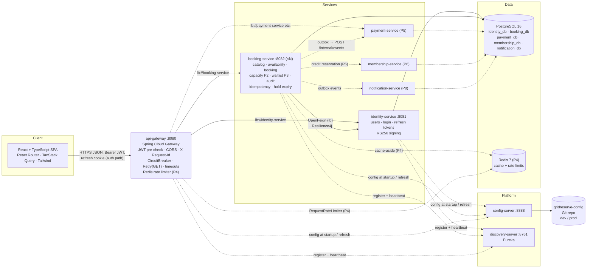
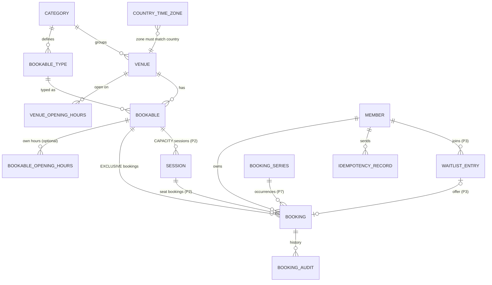
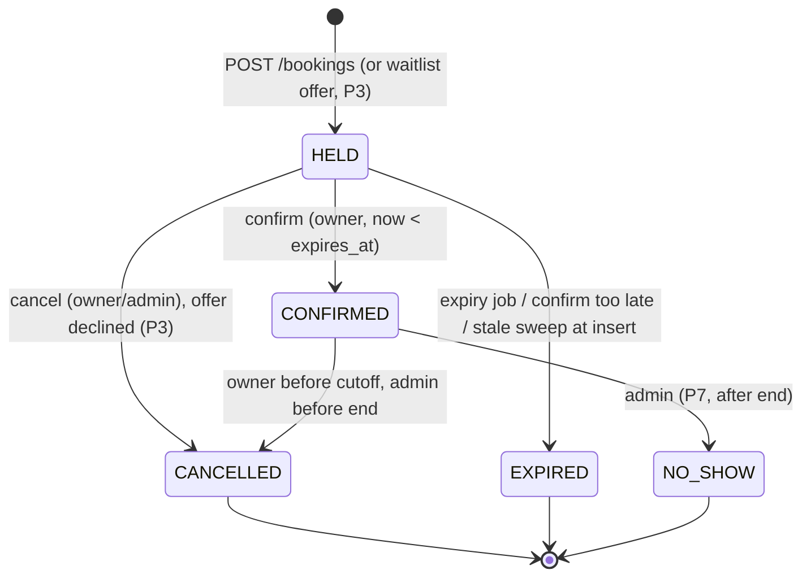
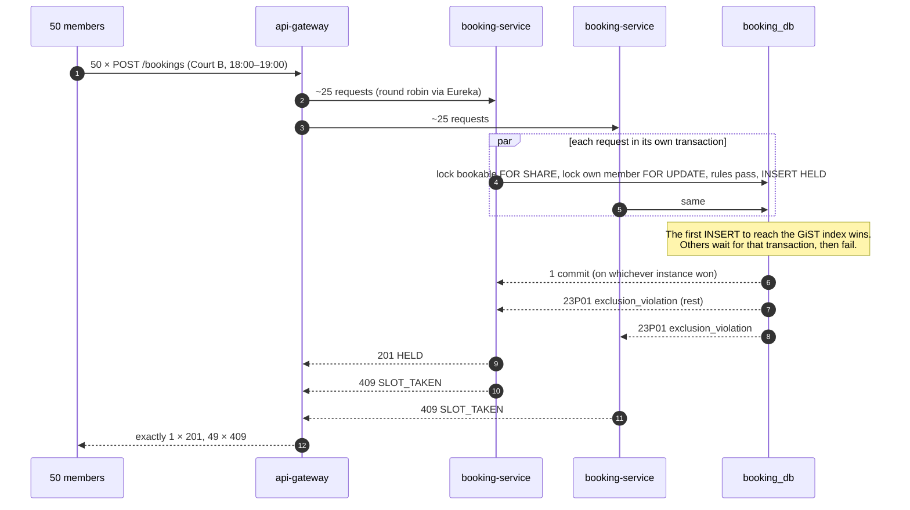
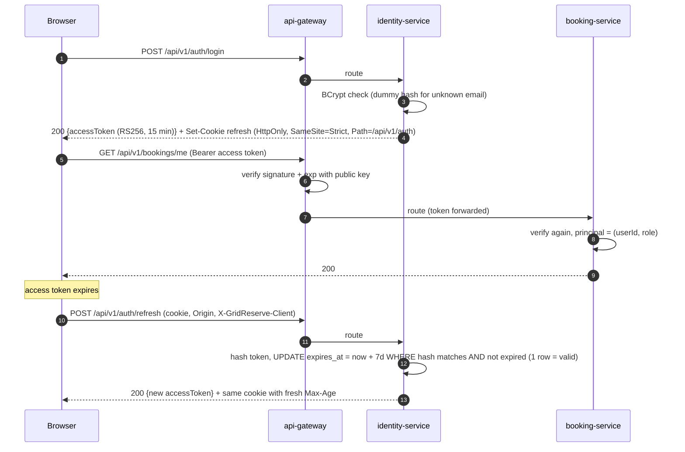
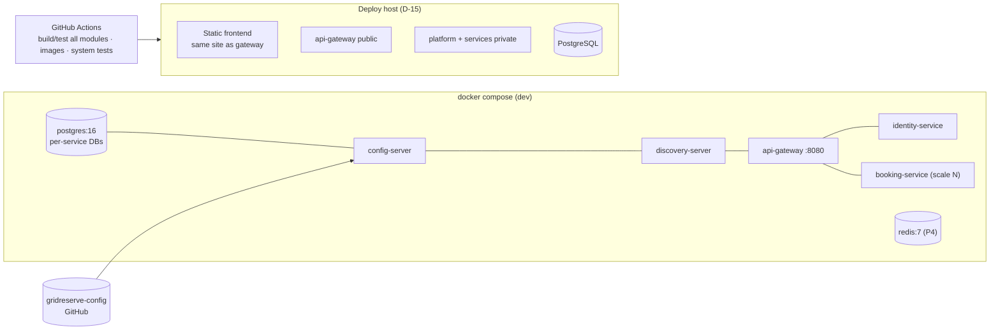

# GridReserve — Architecture

> Version 0.2 (draft). Based on [PROJECT.md](PROJECT.md) v0.3, [REQUIREMENTS.md](REQUIREMENTS.md) v0.2 and [TECH_STACK.md](TECH_STACK.md) v0.2.
> Requirement IDs (`BR-10`, `PLAT-02`, `RES-03`, …) refer to REQUIREMENTS.md. Decision IDs (`D-01`, …) refer to section 19.
> This is a design document. SQL and code fragments are **proposals** to make the design concrete; nothing is implemented yet.
> Changes from v0.1: microservices from the start (config server, Eureka, gateway, identity and booking services; payment, membership, notification later); database per service; Spring Boot 4 / Spring Cloud; resilience patterns; outbox + HTTP push between services; bookable types (library seats and reading halls); venue country + zone; RS256 tokens with refresh-token cookie. The booking engine design (constraints, locks, holds, waitlist) is unchanged and now lives entirely inside the booking service.

## Contents
1. [Principles](#1-principles)
2. [High-level architecture](#2-high-level-architecture)
3. [Repository and module structure](#3-repository-and-module-structure)
4. [Frontend structure](#4-frontend-structure)
5. [Data model per service](#5-data-model-per-service)
6. [Booking lifecycle and state transitions](#6-booking-lifecycle-and-state-transitions)
7. [Transaction boundaries and isolation](#7-transaction-boundaries-and-isolation)
8. [Correctness under contention](#8-correctness-under-contention)
9. [Holds, expiry, cancellation and waitlist promotion](#9-holds-expiry-cancellation-and-waitlist-promotion)
10. [Background workers and bounded thread pools](#10-background-workers-and-bounded-thread-pools)
11. [Communication between services](#11-communication-between-services)
12. [Configuration, profiles and discovery](#12-configuration-profiles-and-discovery)
13. [Resilience patterns](#13-resilience-patterns)
14. [Redis key design (Phase 4)](#14-redis-key-design-phase-4)
15. [Error handling, retries, idempotency and recovery](#15-error-handling-retries-idempotency-and-recovery)
16. [Authentication and authorization](#16-authentication-and-authorization)
17. [Observability and performance testing](#17-observability-and-performance-testing)
18. [Deployment view](#18-deployment-view)
19. [Design decisions: settled and unresolved](#19-design-decisions-settled-and-unresolved)
20. [Known inconsistencies](#20-known-inconsistencies)

---

## 1. Principles

1. **PostgreSQL decides, inside one service.** Every booking outcome is decided by one booking-service transaction, guarded by constraints, conditional updates or row locks. No booking decision ever spans two services (NFR-DATA-05).
2. **No read-then-write for scarce things.** Slots, seats, credits and limits are claimed in one SQL statement or under a lock.
3. **Correctness never depends on timing, on Redis, or on which instance handles a request.** Jobs are safety nets; any number of instances may run.
4. **Split by business capability, not by table.** The booking core (catalog, availability, booking, capacity, waitlist) is one service because its guarantees are transactional.
5. **Every remote call is protected.** Timeout, circuit breaker, bulkhead, and retry only when idempotent. No remote call inside a database transaction.
6. **Reliable side effects use the outbox.** If losing a side effect would be a bug, it is either in the same transaction or in the outbox.
7. **Configuration is central; rules are data.** Infrastructure settings live in the config repo; booking rules live in the booking database.

## 2. High-level architecture

### 2.1 Runtime view (Phase 1, with later services dashed)



### 2.2 Request path

1. Browser → gateway (`/api/v1/...`). Gateway adds `X-Request-Id`, checks CORS, verifies the JWT signature and expiry for protected routes, applies route resilience (and rate limits in P4).
2. Gateway matches the path against its routes. Each service lists the path prefixes it owns (booking: `/api/v1/categories`, `/countries`, `/venues`, `/bookables`, `/bookings`, `/admin/bookings`; identity: `/api/v1/auth`, `/api/v1/me`); there is **no catch-all**, so route order does not matter, a new service cannot be swallowed by another's route, and an unknown path gets the gateway's own 404 (decided 2026-11-05 in the M1.1 review). It then resolves the target service ID through Eureka and picks an instance (round robin).
3. The service verifies the JWT again (defence in depth), runs its logic and transaction, and returns DTOs or the standard error JSON.
4. If the service needs data from another service (booking → identity for member emails in admin lists), it calls it through a load-balanced, resilience-wrapped `RestClient`, **outside** any open transaction.

## 3. Repository and module structure

### 3.1 Monorepo layout

```
~/Developer/project/GridReserve/     (application repo → github.com/chhavinath-bit/GridReserve)
├── backend/                         all Java; Maven runs here
│   ├── pom.xml                      parent: Spring Boot 4 parent, Spring Cloud BOM, versions, modules, plugins
│   ├── mvnw, .mvn/
│   ├── platform/                    infrastructure services (siblings, not nested in each other)
│   │   ├── config-server/
│   │   ├── discovery-server/
│   │   └── api-gateway/
│   ├── services/                    business services
│   │   ├── identity-service/
│   │   ├── booking-service/
│   │   ├── payment-service/         (P5)
│   │   ├── membership-service/      (P6)
│   │   └── notification-service/    (P8)
│   └── libs/
│       └── common-web/              error format, ErrorCode base, RequestIdFilter, JWT verifier,
│                                    event envelope, outbox/inbox helpers (P5)
├── frontend/
├── infra/
│   ├── compose.yaml                 postgres, platform, services, redis (P4); mounts ../../gridreserve-config in dev
│   ├── .env.example                 placeholders only (.env is git-ignored)
│   └── postgres/init-databases.sh   CREATE DATABASE/USER per service (passwords from env)
├── scripts/refresh-config.sh        Eureka lookup + POST /actuator/refresh per instance
├── .github/workflows/
└── docs/PROGRESS.md

~/Developer/project/gridreserve-config/   (separate config repo, sibling folder → github.com/chhavinath-bit/gridreserve-config)
├── application.yml                  shared defaults (resilience defaults, actuator, logging)
├── application-dev.yml
├── application-prod.yml
├── api-gateway.yml / -dev.yml / -prod.yml        routes, CORS, rate limits (P4)
├── identity-service.yml / -dev.yml / -prod.yml
├── booking-service.yml / -dev.yml / -prod.yml    job intervals, client policies, event subscriptions (P5)
└── README.md                        what is refreshable, never put secrets here
```

### 3.2 Inside a service (feature, then layer)

Backend paths are relative to `backend/`. Example: `services/booking-service`, base package `com.gridreserve.booking`:

```
com.gridreserve.booking
├── BookingServiceApplication.java
├── config/              SecurityConfig, ClockConfig, SchedulingConfig (bounded pools), ResilienceProperties
├── common/
│   ├── exception/       ConstraintViolationMapper, service-specific ErrorCodes
│   └── tx/              TransientFailureRetry
├── catalog/
│   ├── controller/      CategoryController, VenueController, BookableController, CountryController
│   ├── dto/             VenueResponse, CreateVenueRequest, BookableResponse, ...
│   ├── service/         CatalogService, RuleResolver → EffectiveRules
│   ├── entity/          Category, BookableType, Venue, Bookable, CountryTimeZone
│   ├── repository/      VenueRepository, BookableRepository, ...
│   └── mapper/          VenueMapper, BookableMapper (hand-written)
├── availability/
│   ├── controller/  dto/  service/ (AvailabilityService, LocalSlotGrid)
├── booking/
│   ├── controller/      BookingController, AdminBookingController
│   ├── dto/             CreateHoldRequest, BookingResponse, ...
│   ├── service/         BookingService, BookingRules (pure), IdempotencyService, SlotReleasedListener (SPI)
│   ├── entity/          Booking, BookingStatus, IdempotencyRecord
│   ├── repository/      BookingRepository (incl. conditional @Modifying updates)
│   ├── mapper/
│   └── job/             HoldExpiryJob, IdempotencyCleanupJob
├── member/              entity/Member, repository/, service/MemberProvisioner
├── audit/               service/AuditService, entity/BookingAudit, repository/
├── client/              IdentityClient (@FeignClient), IdentityGateway (Resilience4j adapter + fallback), dto/
├── capacity/            [P2] same layer folders
├── waitlist/            [P3] ... PromotionService implements SlotReleasedListener
├── cache/               [P4] AvailabilityCache
├── outbox/              [P5] OutboxWriter, OutboxRelay
├── recurring/           [P7]
└── queue/               [P8] walk-in queue
```

`identity-service` (`com.gridreserve.identity`): `user`, `auth` (login, refresh, logout, `JwtSigner`), `refresh` (refresh token store, sliding expiry), `security`, later `venuemanager` (P6).

**Rules inside a service** (unchanged from v0.1): modules call each other only through services and DTOs; no cycles (lower modules define SPIs such as `SlotReleasedListener`); only the `booking` module writes the `booking` table; layer folders `controller` / `dto` / `service` / `entity` / `repository` / `mapper` inside each feature.

### 3.3 Rules between services

- **No shared database access.** A service touches only its own database (PLAT-08).
- **Shared library is thin.** `libs/common-web` contains only cross-cutting web/security plumbing and the event envelope. No entities, no repositories, no business rules (NFR-MAINT-03). DTOs of one service's API are owned by that service; a consumer defines its own client-side DTOs (tolerant reader: ignores unknown fields).
- **Synchronous calls** only for reads that enrich a response or for idempotent commands; never inside a transaction; always resilience-wrapped (§13).
- **Asynchronous events** for "something happened" across services (P5+), through the outbox (§11.2).
- **No distributed transactions** (no 2PC/XA). Cross-service consistency uses outbox events, idempotent commands and, in P6, a reservation saga (§11.3).

## 4. Frontend structure

```
frontend/
├── vite.config.ts            dev proxy /api → http://localhost:8080 (gateway)
├── playwright.config.ts      e2e against the Compose stack
├── e2e/                      journey.spec.ts, race.spec.ts, refresh.spec.ts, degraded.spec.ts
└── src/
    ├── main.tsx              QueryClientProvider, RouterProvider, AuthProvider
    ├── app/                  routes (React Router), layout, RequireAuth / RequireAdmin guards
    ├── api/
    │   ├── client.ts         fetch wrapper: in-memory access token, credentials:'include' for /auth,
    │   │                     X-GridReserve-Client header, single-flight refresh on 401 TOKEN_EXPIRED,
    │   │                     ApiError parsing, Idempotency-Key on POST /bookings
    │   ├── types.ts          DTO types mirroring backend
    │   ├── errors.ts         code → message map (incl. 503/504 "temporarily unavailable")
    │   └── queryKeys.ts
    ├── features/
    │   ├── auth/             LoginPage, RegisterPage, AuthContext (access token in memory)
    │   ├── catalog/          CategorySelect, VenueList, BookableList (grouped by type label)
    │   ├── availability/     SlotPicker, useAvailability
    │   ├── bookings/         HoldPanel, MyBookingsPage, useCreateHold, useConfirm, useCancel
    │   └── admin/            VenuesAdmin (country → zone select), BookablesAdmin, AllBookingsPage, AuditDrawer
    ├── components/ui/
    └── lib/                  time.ts (Intl), idempotency.ts
```

| Query key | Invalidated by |
|---|---|
| `['categories']` | — (long `staleTime`) |
| `['countries']`, `['countryZones', code]` | — |
| `['venues', categoryId]`, `['bookables', venueId]` | admin mutations |
| `['availability', bookableId, date]` | create/confirm/cancel, `409 SLOT_TAKEN` / `MEMBER_OVERLAP` |
| `['bookings','me',filters]` | create/confirm/cancel |
| `['admin','bookings',filters]` | admin cancel |

**Refresh flow.** On app start, the client calls `POST /api/v1/auth/refresh` (cookie sent automatically). On `401 TOKEN_EXPIRED`, it runs **one** shared refresh (concurrent requests wait for the same promise), then retries the original request once. If refresh fails, it clears state and redirects to login with `returnTo`.

## 5. Data model per service

### 5.1 Ownership

| Database | Owner | Main tables |
|---|---|---|
| `identity_db` | identity-service | `app_user`, `refresh_token`, `user_identity` (M1.3d), (P6) `venue_manager_assignment` |
| `booking_db` | booking-service | `member`, `category`, `bookable_type`, `country_time_zone`, `venue`, `bookable`, `booking`, `booking_audit`, `idempotency_record`, (P2) `session`, (P3) `waitlist_entry`, (P5) `outbox_event`, `processed_event`, (P7) `booking_series`, (P8) `queue_entry` |
| `payment_db` | payment-service (P5) | `payment`, `payment_webhook_event`, `refund`, `outbox_event`, `processed_event` |
| `membership_db` | membership-service (P6) | `membership_plan`, `membership`, `credit_reservation`, `processed_event` |
| `notification_db` | notification-service (P8) | `notification`, `email_outbox`, `processed_event` |

Cross-service references are plain IDs (for example `booking.member_id` = identity user ID), never foreign keys across databases.

### 5.2 booking_db relationships



### 5.3 booking_db schema (Phase 1)

> **Implemented in M1.2** as Flyway `V1`–`V4` in `services/booking-service/src/main/resources/db/migration/`; **the migrations are the source of truth**. Differences from the sketch below: every constraint is explicitly named (`pk_`, `fk_`, `uq_`, `ck_`, `ex_`), the bookable override columns have the same CHECKs as the type's columns (`ck_bookable_slot`, `ck_bookable_buffer`, `ck_bookable_durations`, `ck_bookable_duration_order`; owner decision 2026-11-05), and `booking_audit` / `idempotency_record` are added in M1.12.

```sql
CREATE EXTENSION IF NOT EXISTS btree_gist;

-- Local row per identity user, used for row locks (BR-08) and as the owner of bookings.
-- Created on first use: INSERT ... ON CONFLICT (id) DO NOTHING. No PII stored here.
CREATE TABLE member (
  id          bigint PRIMARY KEY,            -- = identity user id (JWT sub)
  created_at  timestamptz NOT NULL
);

CREATE TABLE category (
  id                              bigint GENERATED ALWAYS AS IDENTITY PRIMARY KEY,
  code                            varchar(30) NOT NULL UNIQUE,      -- STUDY, SPORTS, PARKING, CLINIC, GYM
  name                            varchar(60) NOT NULL,
  cancellation_cutoff_minutes     int NOT NULL DEFAULT 120,
  max_active_bookings_per_member  int NOT NULL DEFAULT 3,
  offer_ttl_minutes               int NOT NULL DEFAULT 10,
  booking_horizon_days            int NOT NULL DEFAULT 7
);

CREATE TABLE bookable_type (
  id                    bigint GENERATED ALWAYS AS IDENTITY PRIMARY KEY,
  category_id           bigint NOT NULL REFERENCES category(id),
  code                  varchar(30) NOT NULL,                       -- ROOM, SEAT, HALL, COURT, ...
  label                 varchar(30) NOT NULL,                       -- UI label
  booking_model         varchar(20) NOT NULL CHECK (booking_model IN ('EXCLUSIVE','CAPACITY')),
  slot_minutes          int CHECK (slot_minutes IN (15,30,60)),     -- null for CAPACITY types
  min_duration_minutes  int,
  max_duration_minutes  int,
  buffer_minutes        int NOT NULL DEFAULT 0 CHECK (buffer_minutes BETWEEN 0 AND 120),
  CONSTRAINT uq_bookable_type_code UNIQUE (category_id, code),
  CHECK (booking_model = 'CAPACITY' OR (slot_minutes IS NOT NULL AND min_duration_minutes <= max_duration_minutes))
);

-- Seeded from IANA zone1970.tab / zone.tab (FR-CAT-14).
CREATE TABLE country_time_zone (
  country_code  char(2)     NOT NULL,         -- ISO 3166-1 alpha-2
  time_zone     varchar(64) NOT NULL,         -- IANA id
  PRIMARY KEY (country_code, time_zone)
);

CREATE TABLE venue (
  id               bigint GENERATED ALWAYS AS IDENTITY PRIMARY KEY,
  category_id      bigint NOT NULL REFERENCES category(id),
  name             varchar(100) NOT NULL,
  address_line     varchar(200),
  country_code     char(2)     NOT NULL,
  time_zone        varchar(64) NOT NULL,
  active           boolean NOT NULL DEFAULT true,
  version          bigint  NOT NULL DEFAULT 0,
  created_at       timestamptz NOT NULL,
  updated_at       timestamptz NOT NULL,
  CONSTRAINT fk_venue_country_zone FOREIGN KEY (country_code, time_zone)
      REFERENCES country_time_zone (country_code, time_zone)
);

-- Weekly opening hours (A-06). One interval per ISO weekday; no row = closed that day.
-- Minutes from local midnight (D-16a): 0..1439 open, 1..1440 close (1440 = 24:00).
CREATE TABLE venue_opening_hours (
  venue_id          bigint   NOT NULL REFERENCES venue(id),
  iso_weekday       smallint NOT NULL CHECK (iso_weekday BETWEEN 1 AND 7),   -- 1 = Monday
  opens_at_minute   int      NOT NULL CHECK (opens_at_minute BETWEEN 0 AND 1439),
  closes_at_minute  int      NOT NULL CHECK (closes_at_minute BETWEEN 1 AND 1440),
  PRIMARY KEY (venue_id, iso_weekday),
  CHECK (opens_at_minute < closes_at_minute)
);

CREATE TABLE bookable (
  id                    bigint GENERATED ALWAYS AS IDENTITY PRIMARY KEY,
  venue_id              bigint NOT NULL REFERENCES venue(id),
  bookable_type_id      bigint NOT NULL REFERENCES bookable_type(id),
  name                  varchar(100) NOT NULL,
  active                boolean NOT NULL DEFAULT true,
  slot_minutes          int,          -- overrides; null = inherit (FR-CAT-04/05)
  min_duration_minutes  int,
  max_duration_minutes  int,
  buffer_minutes        int,
  version               bigint NOT NULL DEFAULT 0,
  created_at            timestamptz NOT NULL,
  updated_at            timestamptz NOT NULL
);
-- "type belongs to the venue's category" (FR-CAT-08) is checked in the service; a trigger is not used.

-- Optional own weekly hours for a bookable. If a bookable has any rows here, they replace the venue's
-- weekly hours entirely (FR-CAT-04); otherwise the venue's hours apply.
CREATE TABLE bookable_opening_hours (
  bookable_id       bigint   NOT NULL REFERENCES bookable(id),
  iso_weekday       smallint NOT NULL CHECK (iso_weekday BETWEEN 1 AND 7),
  opens_at_minute   int      NOT NULL CHECK (opens_at_minute BETWEEN 0 AND 1439),
  closes_at_minute  int      NOT NULL CHECK (closes_at_minute BETWEEN 1 AND 1440),
  PRIMARY KEY (bookable_id, iso_weekday),
  CHECK (opens_at_minute < closes_at_minute)
);

CREATE TABLE booking (
  id              bigint GENERATED ALWAYS AS IDENTITY PRIMARY KEY,
  member_id       bigint NOT NULL REFERENCES member(id),
  bookable_id     bigint NOT NULL REFERENCES bookable(id),
  session_id      bigint,                              -- FK added in P2; null for EXCLUSIVE (CAP-09)
  start_time      timestamptz NOT NULL,
  end_time        timestamptz NOT NULL,
  occupied_until  timestamptz NOT NULL,                -- end_time + buffer, snapshotted at insert (§5.5)
  status          varchar(20) NOT NULL CHECK (status IN ('HELD','CONFIRMED','CANCELLED','EXPIRED')),
  expires_at      timestamptz,
  cancelled_at    timestamptz,
  cancelled_by    varchar(10) CHECK (cancelled_by IN ('MEMBER','ADMIN','SYSTEM')),
  cancel_reason   varchar(200),
  created_at      timestamptz NOT NULL,
  updated_at      timestamptz NOT NULL,
  CHECK (start_time < end_time),
  CHECK (occupied_until >= end_time),
  CHECK ((status = 'HELD') = (expires_at IS NOT NULL)),

  CONSTRAINT ex_booking_bookable_overlap EXCLUDE USING gist (
    bookable_id WITH =,
    tstzrange(start_time, occupied_until, '[)') WITH &&
  ) WHERE (status IN ('HELD','CONFIRMED') AND session_id IS NULL),

  CONSTRAINT ex_booking_member_overlap EXCLUDE USING gist (
    member_id WITH =,
    tstzrange(start_time, end_time, '[)') WITH &&
  ) WHERE (status IN ('HELD','CONFIRMED'))
);

CREATE INDEX ix_booking_member_active  ON booking (member_id, end_time) WHERE status IN ('HELD','CONFIRMED');
CREATE INDEX ix_booking_held_expiry    ON booking (expires_at)          WHERE status = 'HELD';
CREATE INDEX ix_booking_bookable_time  ON booking (bookable_id, start_time);

CREATE TABLE booking_audit (
  id             bigint GENERATED ALWAYS AS IDENTITY PRIMARY KEY,
  booking_id     bigint NOT NULL REFERENCES booking(id),
  from_status    varchar(20),
  to_status      varchar(20) NOT NULL,
  actor_type     varchar(10) NOT NULL CHECK (actor_type IN ('MEMBER','ADMIN','SYSTEM')),
  actor_user_id  bigint,                         -- identity user id, no FK across services
  reason         varchar(200),
  occurred_at    timestamptz NOT NULL
);
CREATE INDEX ix_booking_audit_booking ON booking_audit (booking_id, occurred_at);

CREATE TABLE idempotency_record (
  member_id        bigint      NOT NULL REFERENCES member(id),
  idem_key         varchar(64) NOT NULL,
  request_hash     char(64)    NOT NULL,
  state            varchar(12) NOT NULL CHECK (state IN ('IN_PROGRESS','COMPLETED')),
  response_status  int,
  response_body    jsonb,
  booking_id       bigint REFERENCES booking(id),
  created_at       timestamptz NOT NULL,
  locked_until     timestamptz NOT NULL,          -- lease (IDEM-05)
  expires_at       timestamptz NOT NULL,          -- +24 h
  PRIMARY KEY (member_id, idem_key)
);
CREATE INDEX ix_idempotency_expiry ON idempotency_record (expires_at);
```

**Why a local `member` table?** The per-member limit (BR-08) needs a row to lock (`SELECT … FOR UPDATE`), and the member-overlap constraint needs a member column. The user table lives in `identity_db`, which the booking service must not touch. A tiny local row (ID only, no personal data) gives a lock target and keeps RES-07 (booking works while identity is down). It is created on first use with `INSERT … ON CONFLICT DO NOTHING`.

### 5.4 identity_db schema (Phase 1)

> `app_user` implemented in M1.3a (`V1__user_schema.sql`, plus `ck_app_user_email_lower`; constraints named `pk_app_user`, `uq_app_user_email`, `ck_app_user_role`), demo users in `V2__seed_demo_users.sql`. `refresh_token` in M1.3b (`V3__refresh_token.sql`). The migrations are the source of truth.

```sql
CREATE TABLE app_user (
  id            bigint GENERATED ALWAYS AS IDENTITY PRIMARY KEY,
  email         varchar(254) NOT NULL,
  password_hash varchar(100) NOT NULL,
  display_name  varchar(100) NOT NULL,
  role          varchar(20)  NOT NULL CHECK (role IN ('MEMBER','ADMIN')),
  enabled       boolean      NOT NULL DEFAULT true,
  created_at    timestamptz  NOT NULL,
  CONSTRAINT uq_app_user_email UNIQUE (email)
);

-- One row per login (D-37): not rotated; refresh moves expires_at; logout deletes the row.
CREATE TABLE refresh_token (
  id            bigint GENERATED ALWAYS AS IDENTITY,
  user_id       bigint NOT NULL,
  token_hash    char(64) NOT NULL,        -- SHA-256 (hex) of the opaque token; the token itself is never stored
  created_at    timestamptz NOT NULL,
  expires_at    timestamptz NOT NULL,     -- slides to now + 7 days on every refresh
  CONSTRAINT pk_refresh_token PRIMARY KEY (id),
  CONSTRAINT fk_refresh_token_user FOREIGN KEY (user_id) REFERENCES app_user(id),
  CONSTRAINT uq_refresh_token_hash UNIQUE (token_hash)
);
CREATE INDEX ix_refresh_token_expires ON refresh_token (expires_at);
CREATE INDEX ix_refresh_token_user ON refresh_token (user_id);

-- M1.3d (planned): sign-in with Google / GitHub (D-35). New migration; app_user.password_hash becomes nullable.
CREATE TABLE user_identity (
  id                bigint GENERATED ALWAYS AS IDENTITY,
  user_id           bigint NOT NULL,
  provider          text   NOT NULL,          -- GOOGLE | GITHUB
  provider_user_id  text   NOT NULL,          -- Google `sub`, GitHub numeric id; never the email
  created_at        timestamptz NOT NULL,
  CONSTRAINT pk_user_identity PRIMARY KEY (id),
  CONSTRAINT fk_user_identity_user FOREIGN KEY (user_id) REFERENCES app_user(id),
  CONSTRAINT uq_user_identity_provider_user UNIQUE (provider, provider_user_id),
  CONSTRAINT ck_user_identity_provider CHECK (provider IN ('GOOGLE', 'GITHUB'))
);
```

### 5.5 Notes carried over from v0.1

- **`occupied_until` is stored**, not a generated column: `timestamptz + interval` is not immutable in PostgreSQL, so it cannot be used in a generated column or index expression; `tstzrange(timestamptz, timestamptz, text)` can. The snapshot also implements FR-CAT-12. Confirm with a migration test in M1.2.
- **Half-open ranges** make back-to-back bookings legal (BR-12).
- **Partial constraints** mean cancelled and expired rows never block anything.

### 5.6 Later-phase tables (outline)

| Phase | DB | Table | Key points |
|---|---|---|---|
| P2 | booking | `session` | `capacity`, `booked`, `CHECK (booked BETWEEN 0 AND capacity)`; sessions of one bookable don't overlap (D-17). Used by Gym CLASS and Study HALL types. |
| P2 | booking | `booking` change | FK `session_id`; partial unique `(session_id, member_id)` for active rows; seat bookings copy session times so `ex_booking_member_overlap` covers them. |
| P3 | booking | `waitlist_entry` | Target (bookable + range or session), status, `joined_at`, `offer_booking_id`; partial unique per member and target. |
| P5 | each producer | `outbox_event` | §11.2. |
| P5 | each consumer | `processed_event` | `event_id` primary key; inserted in the same transaction as the handler's effect. |
| P5 | payment | `payment`, `payment_webhook_event (provider_event_id UNIQUE)`, `refund` | Payment state machine. |
| P6 | membership | `membership_plan`, `membership (credits_remaining CHECK >= 0)`, `credit_reservation` | Reservation saga (§11.3). |
| P6 | identity | `venue_manager_assignment` | Scope source for VENUE_MANAGER; copied into the JWT (`venueIds` claim) or looked up (D-26). |
| P7 | booking | `booking_series` | Rule in local wall-clock time; occurrences are ordinary bookings. |
| P8 | booking / notification | `queue_entry`; `notification`, `email_outbox` | Queue position derived from `(created_at, id)`. |

## 6. Booking lifecycle and state transitions

Unchanged from v0.1.



Every transition is one conditional UPDATE naming the expected state, for example:

```sql
UPDATE booking SET status = 'CONFIRMED', expires_at = NULL, updated_at = :now
WHERE id = :id AND member_id = :memberId AND status = 'HELD' AND expires_at > :now;
```

1 row → success (+ audit row in the same transaction). 0 rows → reload to decide `404` / `409 HOLD_EXPIRED` (and mark EXPIRED) / `409 INVALID_STATE`.

**Waitlist entry (P3):** `WAITING → OFFERED → ACCEPTED | DECLINED | EXPIRED`; `WAITING → SKIPPED | LEFT | EXPIRED`. An offer is an ordinary HELD booking with a longer expiry.

## 7. Transaction boundaries and isolation

- **READ COMMITTED** everywhere; correctness from constraints, conditional UPDATEs (re-evaluated on the newest row version after waiting) and row locks. SERIALIZABLE is not used.
- `@Transactional` on service methods; one business transaction per request, plus short idempotency transactions (§15.3).
- **No remote call inside a transaction** (RES-10). Enrichment calls (identity lookups) happen before or after the transaction.
- **No transaction spans services.** Cross-service effects go through the outbox (§11.2) or idempotent commands (§11.3).

| Use case (booking-service) | Transaction contents | Locks (in order) |
|---|---|---|
| Create hold (EXCLUSIVE) | Ensure member row; load bookable + rules; validate; expire stale holds (bookable and member); count member's active bookings in category; insert; audit; complete idempotency record | `venue FOR SHARE` → `bookable FOR SHARE` → `member FOR UPDATE` → inserted row |
| Claim seat (P2) | Same, with `UPDATE session … booked < capacity` | `session` (UPDATE) → `member FOR UPDATE` |
| Confirm | Conditional UPDATE + audit | booking row |
| Cancel | Conditional UPDATE + audit (+ seat release P2, + promotion P3, + outbox event P5) | `bookable FOR UPDATE` / session → waiter `member` rows → booking rows |
| Expire one hold (job) | Same as cancel | Same as cancel |
| Deactivate bookable (soft close) | Set `active = false`; (P3) expire its WAITING waitlist entries; audit; return count of active future bookings for information. Existing bookings untouched | `bookable FOR UPDATE` |
| Deactivate venue | Set venue `active = false`; (P3) expire WAITING entries of its bookables | `venue FOR UPDATE` (hold creation reads venue `FOR SHARE` before the bookable) |
| Admin edit | Optimistic `version` → `409 STALE_UPDATE` | — |
| Availability | Read-only | none |
| Admin booking list | Read-only transaction, **then** (after it closes) batched identity lookup with fallback | none |

## 8. Correctness under contention

### 8.1 Mechanisms

| Contention point | Guarantee | Mechanism | Loser gets |
|---|---|---|---|
| Same slot / overlapping range | ≤ 1 active booking (BR-10) | `ex_booking_bookable_overlap` | `409 SLOT_TAKEN` |
| One member, overlapping times | ≤ 1 active booking at any instant (BR-11) | `ex_booking_member_overlap` | `409 MEMBER_OVERLAP` |
| Per-member limit | never > N (BR-08) | `member FOR UPDATE`, then count, then insert | `422 MEMBER_LIMIT_REACHED` |
| Last seat (P2) | `booked ≤ capacity` | `UPDATE … WHERE booked < capacity` + CHECK | `409 SESSION_FULL` |
| Seat release (P2) | `booked ≥ 0` | release only in the transaction whose conditional status UPDATE succeeded | — |
| Confirm vs expire | exactly one wins | conditional UPDATE | `409 HOLD_EXPIRED` |
| Retry / double click | one booking per intent | `idempotency_record` PK + lease | replay / `409 IDEMPOTENCY_IN_PROGRESS` |
| Deactivate vs hold (CONC-09) | no hold created after deactivation commits; earlier holds stay valid | hold: `FOR SHARE` on venue and bookable + re-check `active`; deactivate: `FOR UPDATE` | `422 BOOKABLE_INACTIVE` |
| Waitlist promotion (P3) | one offer per freed slot/seat | promotion in the releasing transaction under the bookable/session lock | — |
| Admin edits | no lost update | `@Version` | `409 STALE_UPDATE` |
| Refresh vs expiry / logout (identity) | an expired or logged-out token is never revived | one conditional `UPDATE refresh_token SET expires_at = :now + 7d WHERE token_hash = ? AND expires_at > :now`; parallel refreshes of the same token all succeed (no rotation, D-37) | `401 REFRESH_TOKEN_INVALID` |
| **Several booking-service instances** | all of the above (CONC-10) | everything is in PostgreSQL; nothing depends on instance memory | — |

### 8.2 Walk-through: 50 members, one slot, two instances



Interview points: all requests pass the Java checks (they read before anyone commits) — the constraint is the guarantee; the instances share nothing but the database; the gateway does **not** retry POSTs, so a lost response cannot create a second booking (the client's idempotency key covers that).

### 8.3 Lock order and deadlocks

Global order in booking-service: (0) venue row, when locked (hold creation `FOR SHARE`, venue deactivation `FOR UPDATE`) → (1) bookable or session row → (2) `member` rows ascending → (3) `booking` rows → (4) waitlist, idempotency, audit, outbox rows. Cancel and expire read the booking without a lock to learn its (immutable) `bookable_id`, lock the bookable, then update the booking. This prevents the cancel-with-promotion vs new-hold deadlock described in v0.1. A defensive retry on `40P01` exists (§15.2); any deadlock is logged as an error.

### 8.4 Not relied on

`synchronized`, in-memory locks, Redis locks, sticky sessions, a single instance, or "check then insert" without the constraint.

## 9. Holds, expiry, cancellation and waitlist promotion

- **Holds** are HELD rows with `expires_at = now + 5 min`; they occupy the slot through the constraint.
- **Expiry, three layers:** (1) confirm after `expires_at` fails and marks EXPIRED; (2) before insert, stale holds on the bookable **and** of the member that overlap the range are expired (FR-EXP-02); (3) `HoldExpiryJob` sweeps every 30 s with `SKIP LOCKED` (safe on N instances). SQL uses `:now` from the injected `Clock`.
- **Cancellation:** read booking → policy check (cutoff) → lock bookable/session → conditional UPDATE → audit → (P2) release seat → (P3) promotion → (P5) outbox event `BookingCancelled` → commit.
- **Waitlist promotion (P3):** synchronous **inside the releasing transaction** via the `SlotReleasedListener` SPI (CXL-07): FIFO, skip ineligible members, insert the offer as a HELD booking with `expires_at = min(now + offerTtl, start)`, at most `K = 20` waiters tried per release. Because it is in the same transaction, a promotion can never be lost and the slot never appears free to others in between. How to try several inserts without aborting the transaction on a constraint violation (`INSERT … ON CONFLICT DO NOTHING` vs savepoints vs pre-check under the bookable lock) is spiked in P3 (D-05).

## 10. Background workers and bounded thread pools

| Pool | Service | Size / bounds | Overload behavior |
|---|---|---|---|
| Tomcat request threads | each MVC service | default 200 (D-09) | queue, then refuse |
| HikariCP | each service with a DB | 10 connections, `connectionTimeout` 5 s | `503` |
| `gr-sched-*` scheduler | booking (identity: token cleanup) | 2 threads | `fixedDelay`, no overlap |
| `gr-relay-*` executor (P5) | each outbox producer | core 2, max 4, queue 100, `CallerRunsPolicy` | relay slows down |
| Resilience4j bulkheads | each outbound client | semaphore, 10 concurrent | fail fast to fallback |
| HTTP client connection pool | each outbound client | bounded (max ~20 per route) | wait up to connect timeout |
| Gateway (Netty event loop) | api-gateway | default | non-blocking; route timeouts |

| Worker | Service | Interval | Multi-instance safety |
|---|---|---|---|
| `HoldExpiryJob` | booking | 30 s | `FOR UPDATE SKIP LOCKED`, per-row transactions |
| `IdempotencyCleanupJob` | booking | hourly | idempotent deletes |
| `WaitlistCloseJob` (P3) | booking | 60 s | conditional UPDATE |
| `OutboxRelay` (P5) | each producer | 1 s | `SKIP LOCKED` |

Every pool is bounded and named; no `@Async` on the default executor; graceful shutdown waits up to 20 s; each batch item is its own transaction so interruption is safe.

## 11. Communication between services

### 11.1 Synchronous calls (P1+)

| Caller → callee | Call | Idempotent? | Policies | Fallback |
|---|---|---|---|---|
| gateway → identity / booking | routed client requests | GET yes, others no | CircuitBreaker, TimeLimiter (5 s), Retry **GET only** | `503 SERVICE_UNAVAILABLE` JSON |
| booking → identity | `GET /internal/users?ids=…` (batch member details for admin views) | yes | Bulkhead 10, CircuitBreaker, Retry 3, timeouts 1 s/2 s | IDs only, `memberDetailsAvailable: false` (RES-06) |
| (P5) outbox relay → subscriber | `POST /internal/events` | yes (event ID) | Bulkhead, CircuitBreaker, Retry + outbox backoff | event stays pending |
| (P5) payment → mock provider | charge / refund | with idempotency key | RateLimiter 20/s, CircuitBreaker, Retry | payment `PENDING`, retried |
| (P6) booking → membership | `POST /internal/credit-reservations` | with idempotency key | Bulkhead, CircuitBreaker, Retry | `503`, booking not attempted |

Clients are **Spring Cloud OpenFeign** interfaces (`@FeignClient(name = "identity-service")`), resolved through Eureka and load-balanced by Spring Cloud LoadBalancer. A Feign request interceptor forwards `X-Request-Id` and a service credential (D-19).

How resilience is attached (keeps each concern in one place):
- **Timeouts** per client in config: `spring.cloud.openfeign.client.config.identity-service.connect-timeout` / `read-timeout` (1 s / 2 s).
- **Feign's own retryer stays off** (Spring Cloud's default `Retryer.NEVER_RETRY`), so retries are never doubled.
- **Retry, CircuitBreaker, Bulkhead** (and RateLimiter where needed) are Resilience4j annotations on a small adapter class per client (e.g. `IdentityGateway`), which calls the Feign interface and owns the fallback. Services depend on the adapter, never on the raw Feign client.
- Feign `ErrorDecoder` turns `4xx` into non-retryable exceptions and `5xx`/IO errors into retryable ones.

### 11.2 Transactional outbox + HTTP push (P5+)

```sql
CREATE TABLE outbox_event (
  id              uuid PRIMARY KEY,           -- event ID, also the receiver's dedupe key
  aggregate_type  varchar(30)  NOT NULL,
  aggregate_id    bigint       NOT NULL,
  event_type      varchar(50)  NOT NULL,      -- BookingCancelled, BookingConfirmed, PaymentSucceeded, ...
  payload         jsonb        NOT NULL,      -- versioned ("v": 1)
  created_at      timestamptz  NOT NULL
);
CREATE TABLE outbox_delivery (                -- one row per (event, subscriber)
  event_id        uuid        NOT NULL REFERENCES outbox_event(id),
  subscriber      varchar(50) NOT NULL,       -- service id, e.g. payment-service
  status          varchar(10) NOT NULL DEFAULT 'PENDING' CHECK (status IN ('PENDING','DONE','FAILED')),
  attempts        int         NOT NULL DEFAULT 0,
  available_at    timestamptz NOT NULL,
  last_error      varchar(500),
  delivered_at    timestamptz,
  PRIMARY KEY (event_id, subscriber)
);
CREATE INDEX ix_outbox_delivery_pending ON outbox_delivery (available_at) WHERE status = 'PENDING';

-- in every consumer
CREATE TABLE processed_event (
  event_id      uuid PRIMARY KEY,
  processed_at  timestamptz NOT NULL
);
```

1. **Write:** in the business transaction, insert `outbox_event` plus one `outbox_delivery` row per subscriber (subscriptions from config, EVT-06).
2. **Relay:** every 1 s, claim up to 50 pending deliveries with `FOR UPDATE SKIP LOCKED`; `POST lb://{subscriber}/internal/events` with the envelope `{eventId, type, occurredAt, payload}`; wrapped in Bulkhead + CircuitBreaker + Retry.
3. **Result:** `2xx` → `DONE`; failure → `attempts + 1`, `available_at = now + backoff` (2 s, 4 s, … max 10 min, jitter); after 10 attempts → `FAILED` (dead letter, metric, admin view). An open circuit for one subscriber does not block deliveries to others.
4. **Receive:** in one transaction, `INSERT INTO processed_event … ON CONFLICT DO NOTHING`; if inserted, apply the effect; commit; return `200`. A duplicate returns `200` with no effect (EVT-04).
5. **Semantics:** at-least-once delivery, exactly-once effect per receiver; no ordering guarantee (EVT-07).

Why HTTP push instead of a broker: no extra infrastructure (owner decision D4); the outbox gives the reliability; the relay is simple to explain. Trade-off: the producer must know subscribers (config) and handle retries itself.

### 11.3 Cross-service saga: membership credits (P6, unresolved D-25)

Booking a class seat with a credit touches two databases. Proposed reservation saga:
1. booking-service calls `POST /internal/credit-reservations {memberId, idempotencyKey}` → membership reserves one credit (`UPDATE membership SET credits_remaining = credits_remaining - 1 WHERE … AND credits_remaining > 0`) and returns a reservation ID with a TTL.
2. booking-service runs its normal seat-claim transaction, storing the reservation ID, and writes `BookingHeld` to its outbox.
3. On confirm → outbox `BookingConfirmed` → membership commits the reservation. On cancel/expiry/failure → outbox `BookingReleased` → membership returns the credit. A reservation that never gets either event expires and returns the credit.

Alternative: keep credits inside booking-service (one transaction, simpler) and let membership-service own only plans. To decide at the start of P6.

## 12. Configuration, profiles and discovery

### 12.1 Startup sequence

```mermaid
sequenceDiagram
    participant S as any service
    participant C as config-server
    participant G as gridreserve-config (Git)
    participant E as discovery-server
    S->>C: GET /{service}/{profile} (spring.config.import=configserver:, fail-fast + retry)
    C->>G: fetch / pull
    C-->>S: merged properties (application.yml + application-{profile}.yml + {service}.yml + {service}-{profile}.yml)
    S->>S: start; Flyway migrates own DB; health UP
    S->>E: register (service id, host, port) + heartbeats
```

- Compose starts PostgreSQL and the config server first (health checks), then the discovery server, then services, then the gateway; clients also retry, so order problems self-heal (NFR-OPS-04).
- Config server location: fixed URL from an environment variable (`CONFIG_SERVER_URL`), not discovered through Eureka, to avoid a startup cycle (D-20).
- If the Config Server is unreachable, a service fails fast and the container platform restarts it with backoff (PLAT-07, spike S6). Eureka keeps its own local config so it never waits for the Config Server.
- Config backend: `native` (mounted local clone, read-only) in `dev`; Git (GitHub) in `prod` (D-33).

### 12.2 Profiles

| | `dev` | `prod` | `test` |
|---|---|---|---|
| Config source | config server `*-dev.yml` | config server `*-prod.yml` + env secrets | local test properties |
| Eureka | on | on | off |
| Cookies | `Secure=false` on localhost | `Secure=true`, `SameSite=Strict` | n/a |
| CORS | `http://localhost:5173` | deployed frontend origin | n/a |
| Logs | DEBUG for `com.gridreserve` | INFO, JSON (D-10) | WARN |
| Actuator | broad, local only | health public on gateway only | as needed |

### 12.3 Refresh (`@RefreshScope`)

- Refreshable settings are grouped in `@ConfigurationProperties` classes (rebound on refresh) or beans annotated `@RefreshScope`: resilience thresholds, rate-limit settings (P4), CORS origins, job intervals, event subscriptions, feature toggles.
- Not refreshable: datasource, ports, signing keys, booking rules (data).
- `scripts/refresh-config.sh`: `GET {eureka}/eureka/apps` → for each instance of the chosen services → `POST http://{host}:{port}/actuator/refresh` with an admin/service credential → print the changed keys per instance. Actuator is not exposed through the gateway.
- Risk: a bad change refreshed into all instances. Mitigation: changes go through PRs in the config repo; resilience settings are validated (`@Validated` properties) so an invalid value is rejected and logged instead of applied.

### 12.4 Discovery and load balancing

- Instances register with `{service-id}`; heartbeats every 30 s (defaults); Eureka evicts dead instances. Clients cache the registry and refresh it periodically, so a short Eureka outage is harmless (NFR-REL-05).
- Spring Cloud LoadBalancer round-robin by default; health-aware via registry status.
- Running `docker compose up --scale booking-service=2` gives two instances on different container IPs; the gateway spreads traffic (used by CONC-10 and FS-34).

## 13. Resilience patterns

### 13.1 Default policy (shared `application.yml` in the config repo, refreshable)

| Setting | Default (A-25) |
|---|---|
| HTTP connect / response timeout | 1 s / 2 s (gateway route response timeout 5 s) |
| CircuitBreaker | count-based window 20, min calls 10, failure rate 50 %, slow call > 2 s at 50 %, open 30 s, 3 half-open calls |
| Retry | 3 attempts, 200 ms × 2 exponential with jitter; retry on IO errors, timeouts, 502/503/504; never on 4xx |
| Bulkhead | semaphore, 10 concurrent, max wait 0 ms |
| RateLimiter | 20 calls per 1 s, wait 0 ms (only on configured clients) |

### 13.2 Where each pattern applies and why

- **CircuitBreaker** wherever a dependency can fail: each gateway route, each service client, each outbox subscriber, Redis (P4). When open, callers stop waiting on a dead service and the dependency gets time to recover.
- **Retry** only where repeating is harmless (RES-03). The gateway retries GET routes only; `POST /bookings` is never retried server-side.
- **Bulkhead** around each outbound client so a slow identity service can use at most 10 of the booking service's threads.
- **RateLimiter** (per instance) on the mock payment provider client (P5); it shapes outbound traffic. Client-facing distributed limits stay in Redis at the gateway (P4).
- **TimeLimiter / timeouts** on everything; a call without a timeout is a bug.

### 13.3 Fallbacks

| Call | Fallback |
|---|---|
| Gateway route open/timeout | `503 SERVICE_UNAVAILABLE` / `504 UPSTREAM_TIMEOUT` in the standard error JSON, with `requestId` |
| booking → identity member details | Return IDs only, `memberDetailsAvailable: false` |
| Outbox delivery | Leave pending; backoff; dead letter after 10 attempts |
| Redis cache (P4) | Read PostgreSQL |
| Redis rate limiter (P4) | Allow (fail open), log WARN, metric |
| booking → membership credit reservation (P6) | `503`; no booking is attempted, so nothing to compensate |

### 13.4 Testing resilience

- Feign client tests against a stub HTTP server (WireMock once approved, D-28): delays beyond the timeout, sequences of 5xx that open the circuit, half-open recovery after a (test-shortened) wait, bulkhead rejection with 11 parallel calls, no retry on 4xx.
- System tests (Compose): stop identity → US-12/FS-32; kill one booking instance under load → FS-34; stop Eureka → FS-38; stop config server → FS-37.

## 14. Redis key design (Phase 4)

| Purpose | Owner | Key | TTL | Operations |
|---|---|---|---|---|
| Availability cache | booking-service | `gr:v1:avail:{bookableId}:{localDate}:{gen}` | 30 s | `GET`; miss → `SET … EX 30` |
| Generation per bookable | booking-service | `gr:v1:avail-gen:{bookableId}` | none (or 1 day) | `INCR` after commit |
| Rate limit: login | api-gateway | managed by Spring Cloud Gateway's `RedisRateLimiter` (token bucket; keys derived from the route and the resolved key, e.g. `request_rate_limiter.{key}.tokens` / `.timestamp`) | set by the limiter | atomic Lua inside Redis |
| Rate limit: booking creation | api-gateway | same, keyed by user ID from the JWT | set by the limiter | atomic Lua |

- **Key resolvers:** login → client IP (hashed); booking creation → `sub` from the verified JWT. Per-email login throttling cannot be done at the gateway without reading the request body, so it moves to identity-service (§20 item 3).
- **Generation counter** prevents a slow reader from writing stale data into the current cache key (see v0.1 reasoning): writers `INCR` after commit; readers read and write under the generation they saw.
- **Failure behavior:** short command timeout (~200 ms), CircuitBreaker around Redis calls in booking-service; fall back to PostgreSQL; gateway limiter fails open (to be verified in M4.x; if it fails closed by default, a custom wrapper is needed — D-07).
- No personal data in keys; every key has a TTL except generation counters.

## 15. Error handling, retries, idempotency and recovery

### 15.1 Errors

- `libs/common-web` provides `ErrorResponse`, a base `ErrorCode`, `DomainException`, and a reusable `@RestControllerAdvice` for MVC services; the gateway has an equivalent WebFlux error handler so its own errors (`401`, `503`, `504`, `429`) use the same JSON (PLAT-12).
- DB constraint violations are mapped **by constraint name** (`ex_booking_bookable_overlap` → `SLOT_TAKEN`, `ex_booking_member_overlap` → `MEMBER_OVERLAP`, `uq_app_user_email` → `EMAIL_TAKEN`); an unknown constraint → `500` + ERROR log.
- Errors from a downstream service are **not** passed through blindly: a client translates them into the caller's own error or fallback.

### 15.2 Retries

| Where | Retried | Never retried |
|---|---|---|
| Inside a service | Whole transaction on `40P01`/`40001`, 3 attempts with jitter (D-11) | `23P01`/`23505` (business conflicts) |
| Service clients | Idempotent calls per RES-03 | 4xx; non-idempotent commands without a key |
| Gateway | GET routes | POST/PUT/DELETE |
| Outbox | Deliveries with backoff | — |
| Frontend | Queries on network/5xx; mutations only on network error or `503` with the same idempotency key | 4xx |

### 15.3 Idempotency for `POST /bookings`

Same three-step design as v0.1 (now keyed by `member_id`): Tx A inserts `IN_PROGRESS` with a 30 s lease → Tx B creates the hold and marks the record `COMPLETED` with the response → on a business error Tx C stores the 4xx response; on a 5xx Tx C deletes the record. Duplicates: different hash → `422`; completed → replay; in progress with a live lease → `409`; expired lease → take over.

### 15.4 Recovery

| Failure | Result |
|---|---|
| Service crash mid-request | Transaction rolls back; client retries with the same idempotency key |
| Booking instance dies | Gateway stops routing to it (health/Eureka eviction); in-flight POSTs fail (client retries); no duplicates |
| Identity down | Booking unaffected for logged-in users; login/refresh `503` |
| Config server down | Running services unaffected; new instances can't start (fail fast) |
| Eureka down | Cached registry keeps routes working |
| Outbox subscriber down | Deliveries retried until it returns; dead letter after 10 attempts |
| PostgreSQL down | All DB-backed services `503`, readiness DOWN |
| Redis down (P4) | Fallbacks (§14) |
| Bad config refreshed | Validation rejects invalid values; revert via config-repo PR + refresh |
| Data loss on host | Backups depend on host (D-15) |

## 16. Authentication and authorization



- **Keys:** identity holds the RS256 private key (env var); the public key(s) with `kid` are distributed through the config repo (not secret). Rotation is manual in P1 (A-27); a JWKS endpoint is a later option (D-23).
- **Verification:** gateway (early rejection) and every service (defence in depth) verify signature, `exp`, issuer and audience.
- **Authorization:** roles via Spring Security in each service; ownership in services (`404` for others' bookings); admins never book for others; VENUE_MANAGER scope (P6) from a `venueIds` claim or lookup (D-26).
- **Refresh tokens (D-37):** opaque 256-bit value, stored as SHA-256, one row per login, **not rotated**; refresh slides the expiry to 7 days from now, logout deletes the row, a disabled user is refused at refresh (FR-AUTH-09..13); CSRF checks (FR-AUTH-12). Expired rows are deleted at login, so no cleanup job. SHA-256 rather than BCrypt: the value is random and high-entropy (nothing to brute-force) and must be found by an indexed lookup. Rejected: rotation with token families and reuse detection (more state, a multi-tab race, a cleanup job; judged too heavy for this project), a stateless JWT refresh token (logout could not end a copied token).
- **Service-to-service authentication** for `/internal/**` and actuator refresh (**D-19, settled 2026-11-06**): short-lived service JWTs signed by identity-service (client-credentials style), verified with the same public keys; built in M1.9 with the first internal call. Rejected: a shared HMAC header per service pair (one more secret per pair, no expiry), network isolation only (no defence if one container is compromised).
- **Register starts a session (D-36):** `/register` answers like `/login` (access token + refresh cookie); both call one `startSession(user)` (M1.3b).
- **Sign-in with Google and GitHub (D-35, M1.3d):** Spring Security's OAuth2 client in identity-service. Flow: `/api/v1/auth/oauth2/authorization/{provider}` → provider → `/api/v1/auth/oauth2/callback/{provider}` → find or link or create the user (verified email only) → `startSession` → redirect to the frontend, which calls `/refresh`. No token in URLs; the authorization request lives in a short-lived cookie, not a session, so several identity instances work. The paths sit under `/api/v1/auth/**`, which the gateway already routes. Rejected: tokens in the redirect URL (leak through history and logs), linking by unverified email (account takeover), a server session for the login state (breaks with several instances).
- **Library (D-34):** Spring Security's OAuth2 resource server with Nimbus JOSE. `common-web` provides the decoder (known `kid`, RS256 signature, expiry by the injected `Clock` with 30 s skew, issuer, audience, `sub`, `role`) and the JSON `401`/`403` handler; each service writes its own `SecurityFilterChain`.
- **Gateway pre-check and defence in depth (D-38, M1.3c):** the gateway refuses requests without a valid token on every path except `/api/v1/auth/**`, the ping, health/info and the fallbacks (unknown paths included), using the same decoder wrapped for WebFlux. It does not check roles. booking-service and identity-service verify the token again and enforce roles (`/api/v1/admin/**` → ADMIN), because they can be reached inside the network without the gateway. Spring checks any Bearer token it sees, even on public paths, so the auth endpoints ignore the `Authorization` header: otherwise an expired access token sent along with `/refresh` would block the refresh.

## 17. Observability and performance testing

- **Logs:** SLF4J/Logback; `X-Request-Id` from the gateway in every log line (MDC) and forwarded on outbound calls; no PII or tokens in logs; JSON in prod (D-10).
- **Metrics (Micrometer, per service):** `http.server.requests`, HikariCP, JVM; Resilience4j (`resilience4j.circuitbreaker.state`, calls, retries, bulkhead and rate-limiter metrics); custom: `gridreserve.bookings.created{category,type}`, `gridreserve.bookings.conflicts{code}`, `gridreserve.holds.expired{layer}`, `gridreserve.db.retries{sqlstate}`, `gridreserve.outbox.pending/failed` (P5), `gridreserve.cache.requests{result}` (P4), gateway rate-limit rejections (P4).
- **Health:** liveness/readiness per service; DB in readiness; Redis not in readiness.
- **Tracing:** request-ID propagation in P1; distributed tracing (Micrometer Tracing + Zipkin or OTLP) pending approval (D-24) — recommended once there are 3+ services.
- **Performance tests (M1.14):** availability p95 and hold creation p95 through the gateway; hot-slot test with 200 requests and two instances; Hikari pool sizing; Redis on/off in P4. Load tool pending (D-13).

## 18. Deployment view



- Only the gateway (and the static frontend) are public; everything else is on a private network.
- Memory budget: ~5 JVMs + PostgreSQL in P1 (A-28); this strongly influences the host choice (D-15).

## 19. Design decisions: settled and unresolved

### 19.1 Settled (with date)

| ID | Decision | Date |
|---|---|---|
| D-01 | One `booking` table for EXCLUSIVE and seat bookings (nullable `session_id`) | 2026-10-26 (design), confirmed by microservice split |
| D-02 | Per-member limit via row lock on the local `member` row | 2026-11-04 |
| D-03 | Waitlist promotion synchronous in the releasing transaction | 2026-11-05 (owner, M0.3) |
| D-20 | Config server reached by a fixed URL (`CONFIG_SERVER_URL`), not through Eureka | 2026-11-05 (M1.1) |
| D-21 | Resilience4j through Spring Cloud CircuitBreaker 5.0.3 (Resilience4j 2.3.0) works on Spring Boot 4.1.2: Feign circuit breaker with fallback (spike S2) and gateway route breaker with JSON fallback (S3) verified | 2026-11-05 (M1.1) |
| D-22 | Gateway: Spring Cloud Gateway Server WebFlux | 2026-11-05 (M1.1) |
| D-27 | `common-web` stays thin (error format, request ID, clock; access-token verification from M1.3a) and is wired by Spring Boot auto-configuration; the reactive gateway has its own small equivalents for errors and request IDs. *Amended by D-38:* the gateway uses `common-web`'s token verification | 2026-11-05 (M1.1) |
| D-19 | Service-to-service authentication: short-lived service JWTs signed by identity-service; built in M1.9 | 2026-11-06 (owner, M1.3) |
| D-34 | JWT library: Spring Security OAuth2 resource server + Nimbus JOSE instead of jjwt (jjwt-jackson needs Jackson 2 next to Boot 4's Jackson 3; built-in Bearer filters for servlet and reactive) | 2026-11-06 (owner, M1.3) |
| D-35 | Sign-in with Google (OIDC) and GitHub (OAuth2) through Spring Security's OAuth2 client; link to existing accounts only by verified email; session handed to the SPA through the refresh cookie; built as M1.3d | 2026-11-06 (owner, M1.3) |
| D-36 | Registering starts a session like login (one `startSession` used by register, login and provider sign-in); built in M1.3b | 2026-11-06 (owner, M1.3) |
| D-33 | Config Server: `native` backend on the mounted local clone in `dev`, Git backend on GitHub in `prod`; startup = fail fast + container restart with backoff, no Spring Retry (spike S6) | 2026-11-05 (M1.1) |
| D-32 | Per-weekday opening hours in P1 (`venue_opening_hours`, optional `bookable_opening_hours`); booking horizon 7 days; Trainer 45 + 15 on a 15-minute grid | 2026-11-05 (owner, M0.3) |
| D-04 | Outbox introduced in P5 with HTTP push, no broker | 2026-11-04 |
| D-12 | Access token in memory + refresh-token cookie (rotation removed by D-37) | 2026-10-26 |
| D-38 | The gateway verifies access tokens with `common-web`'s `AccessTokenVerification` (the same rules as every service), wrapped as a reactive decoder; `spring-boot-starter-webmvc` is optional in `common-web` so the gateway stays reactive. The gateway checks only that a token is valid; roles are checked in each service, which also verifies the token again. `/api/v1/auth/**` ignores the `Authorization` header (gateway and identity). `member` rows are created by `MemberProvisioner` from hold creation (M1.5), not on every request. Rejected: a separate copy of the rules in the gateway (could drift), provisioning in a request filter (a write on every request) | 2026-11-06 (owner, M1.3c) |
| D-37 | Refresh token: opaque, hashed, one row per login, sliding 7-day expiry, not rotated; logout deletes the row; expired rows deleted at login | 2026-11-06 (owner, M1.3b) |
| D-13a | React Router; Vitest + RTL + Playwright | 2026-10-26 |
| D-14 | `409 STALE_UPDATE` for optimistic-lock conflicts | 2026-11-04 |
| D-16a | Opening hours stored as minutes from local midnight (0–1440) | 2026-11-04 |
| D-18 | Concurrency tests go through HTTP; CONC-10 through the gateway with two instances | 2026-11-04 |
| D-31 | Layout `backend/` + `frontend/` + `infra/`; config repo sibling folder, local clone in dev; feature-then-layer packages; Spring Cloud OpenFeign for service-to-service calls | 2026-11-05 (owner) |
| D-30 | Microservices from the start; booking core in one service; monorepo; separate config repo; per-instance refresh; Spring Boot 4; venue country + zone; library seats EXCLUSIVE + halls CAPACITY | 2026-11-04 (owner) |

### 19.2 Unresolved

| ID | Decision | Options | Recommendation | Needed by |
|---|---|---|---|---|
| D-05 | Trying several waitlist offers in one transaction | `ON CONFLICT DO NOTHING` / savepoints / pre-check under lock | Spike | P3 |
| D-06 | Cache TTL, Redis timeouts | 15–60 s; 100–500 ms | 30 s, 200 ms | P4 |
| D-07 | Gateway rate limiter behavior when Redis is down | Built-in default / custom fail-open wrapper | Verify built-in; wrap if it fails closed | P4 |
| D-08 | Clock source and skew across instances | App `Clock` as `:now` / DB `now()` | App clock; NTP-synced hosts | P1 |
| D-09 | Virtual threads, Tomcat thread limit | on/off | Off until measured | M1.14 |
| D-10 | JSON logs in prod | Logback encoder (may need a library) / plain | Decide with host | First deploy |
| D-11 | Transaction retry on deadlock | hand-written / Spring Framework 7 `@Retryable` / none | Spring 7 `@Retryable` if suitable, else hand-written | P1 |
| D-13b | Load-test tool | JUnit harness / k6 / Gatling | JUnit harness first | M1.14 |
| D-15 | Deploy host, backups, rollback (must fit ~5 JVMs) | Depends on host | Decide at M1.10 with current limits | M1.10 |
| D-16b | DST-ambiguous local times in the slot grid | first occurrence / both / skip | Show both with UTC offset | P7 |
| D-17 | Overlapping sessions on one CAPACITY bookable | forbid / allow | Forbid | P2 |
| D-23 | Public-key distribution | config repo / JWKS endpoint | Config repo in P1, JWKS later | P1 / later |
| D-24 | Distributed tracing | Micrometer Tracing + Zipkin / OTLP / none | Add when approved | P5+ |
| D-25 | Membership credits | reservation saga / keep credits in booking-service | Decide at P6 start | P6 |
| D-26 | VENUE_MANAGER scope source | JWT claim / lookup from identity | JWT claim (refresh picks up changes) | P6 |
| D-28 | Stub HTTP server for Feign client tests | WireMock / JDK `HttpServer` (no dependency, clunky) / Spring Cloud Contract stubs | WireMock (needs approval) | M1.9 |

## 20. Known inconsistencies

| # | Where | Issue | Resolution |
|---|---|---|---|
| 1 | v0.1 §17 items 1–7 (generated column, promotion after commit, member stale holds, DB clock, idempotency lease, `STALE_UPDATE`, router) | — | **Resolved** in REQUIREMENTS.md v0.2 and this document (2026-11-04). |
| 2 | REQUIREMENTS.md CXL-07 / D-03 | Synchronous promotion was marked "confirm at P3 start" | **Resolved** 2026-11-05: confirmed by the owner. |
| 3 | REQUIREMENTS.md NFR-SEC-06 / A-14 | "Login 5 per minute per (IP, email)" — the gateway limiter cannot key on the email without reading the body | Proposal: gateway limits per IP; identity-service adds per-email failed-login throttling (P4). Needs a REQUIREMENTS update when P4 starts. |
| 4 | Memory budget (A-28) vs free hosting tiers | ~5 JVMs may not fit common free tiers | Resolve with D-15 at M1.10. |
| 5 | Resilience4j Boot 4 support | Not confirmed when written | M1.1 spike (D-21). |
